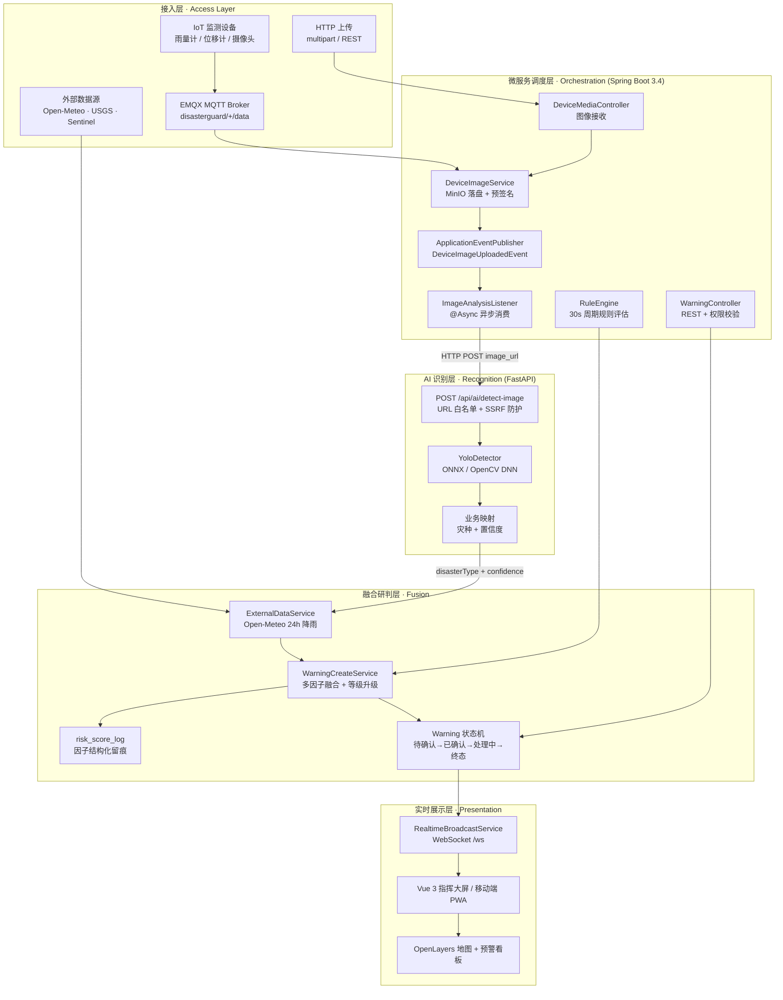
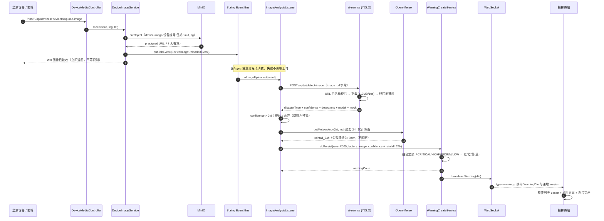

# 御灾智巡 · DisasterGuard

**基于多源数据融合与 AI 智能研判的自然灾害监测预警与应急指挥平台**

[](https://spring.io/)
[](https://openjdk.org/)
[](https://vuejs.org/)
[](https://fastapi.tiangolo.com/)
[](https://postgis.net/)

面向地质灾害与气象灾害的**全链路闭环平台**：从设备图像接入、视觉识别、气象因子融合，到预警生成、状态流转、指挥推送，形成一条可追溯的自动化流水线。

---

## 目录

- [核心优势](#核心优势)
- [系统架构](#系统架构)
- [核心业务流](#核心业务流)
- [技术栈](#技术栈)
- [快速启动](#快速启动)
- [端口约定](#端口约定)
- [项目结构](#项目结构)
- [开发账号](#开发账号)
- [文档导航](#文档导航)
- [安全须知](#安全须知)

---

## 核心优势

### 1. 事件驱动架构

图像接收与 AI 研判之间没有直接调用，而是通过 Spring 的 `ApplicationEventPublisher` 发布 `DeviceImageUploadedEvent`。上传接口只负责"存证"，研判链路完全独立——识别失败、超时、模型不可用都不会反噬"图片已收妥"这一事实。

```text
DeviceImageService ──publishEvent──▶ ApplicationEventBus ──@Async──▶ ImageAnalysisListener
```

### 2. 异步微服务解耦

- **进程级**：Java 后端与 Python 推理服务独立部署、独立扩缩容。图像推理可单独指向带 GPU 的实例（`AI_IMAGE_SERVICE_URL`），不必连带换掉全部分析服务。
- **线程级**：`@Async` 监听器消费事件，秒级的 YOLO 推理不再占用 Tomcat 工作线程，设备上传接口的响应时间与模型耗时彻底解耦。
- **失败隔离**：`AiImageClient` 捕获所有异常返回 `null`，调用方按"本次跳过"处理，不引入异常传播。

### 3. 多源数据融合

单靠图像置信度不足以定级，平台在生成预警时融合多类因子：

| 因子 | 来源 | 作用 |
|---|---|---|
| 视觉置信度 | Python YOLO（`/api/ai/detect-image`） | 判定灾种与初步风险 |
| 24h 累计降雨 | Open-Meteo（`ExternalDataService`） | 提升/压低风险等级 |
| 地面监测指标 | IoT 设备经 EMQX MQTT 上报 | 触发规则引擎 |
| 遥感与气象产品 | Sentinel-1/2、GPM、SMAP、ERA5 | 宏观态势与趋势 |

所有因子写入 `risk_score_log.factors` 结构化留存，预警事后可复盘"为什么是这一级"。

### 4. 毫秒级 WebSocket 推送

后端进程内广播（`RealtimeBroadcastService`），预警落库后立即推送到所有在线指挥终端，无需前端轮询：

```json
{ "type": "warning", "data": { "warningCode": "WG-20261026-001" }, "version": 1761456000123 }
```

支持一次性 ticket 鉴权（`GET /api/auth/ws-ticket`），避免 JWT 长期暴露在 WebSocket URL 中。

---

## 系统架构



> 说明：`backend` 是**模块化单体**（单一 Spring Boot 进程，按 `device` / `warning` / `ai` / `hazard` 等领域分包），
> 与 `ai-service` 之间才是真正的独立进程边界。上图的"调度层"指的是模块间的编排职责，不是独立部署单元。

---

## 核心业务流

**设备上传图片 → 异步调用 Python YOLO → Open-Meteo 气象融合 → 状态机预警 → 前端推送**



**关键设计取舍**

| 环节 | 取舍 | 原因 |
|---|---|---|
| 上传即返回 | 不等待识别 | 识别是秒级外部调用，同步会拖垮设备接口 |
| 置信度阈值 0.8 | 低于阈值只记日志 | 避免误报淹没指挥台 |
| 气象失败给 0mm | 不阻断预警 | 气象是增强信息，不是必要条件 |
| 视觉灾种映射 | 检测模型是真实 2 类业务模型：`crack→崩塌`、`landslide→滑坡`；COCO 占位模型或启发式 mock 一律返回 `none` | 灾种判定与"是否为真实业务模型"强绑定，杜绝占位模型把任意框误判成灾种 |

> **AI 视觉检测模型现状**：`ai-service/models/yolo_crack.onnx` 是用 `datasets/disaster-v2`（770 张影像 / 2632 个实例，crack + landslide 两类）训练的 **YOLOv8n 真实业务模型**，已导出 ONNX 并由 `onnxruntime` 加载（`is_business_model=True`）。同测试集（71 图 / 206 实例）实测 test mAP50≈0.327（crack 0.36 / landslide 0.30），对真实裂缝与滑坡图有稳定检出；模型缺失或加载失败时自动降级为 `mock:true` 的空结果，接口仍可用。训练数据、指标与归因详见 `ai-service/models/README.md` 与 `ai-service/datasets/disaster-v2/DATASET_CARD.md`。

---

## 技术栈

| 层级 | 技术选型 |
|---|---|
| 前端 | Vue 3.5 · Vite 6 · Vue Router 4 · Pinia · OpenLayers 10 · Cesium 1.144 |
| 后端 | Spring Boot 3.4.1 · Java 17 · Spring Data JPA · Hibernate Spatial · Spring Security (JWT) · Spring StateMachine |
| AI 服务 | Python 3.11 · FastAPI 0.115 · Pydantic 2.10 · YOLO (ONNX/OpenCV DNN) · NumPy/SciPy |
| 基础设施 | PostgreSQL 15 + PostGIS 3.4 · Redis 7 · MinIO · EMQX 5.9 · TDengine 3.2 |
| 实时通信 | 原生 WebSocket（`/ws`，一次性 ticket 鉴权）· MQTT（设备接入） |

---

## 快速启动

### 0. 前置要求

- **JDK 17+**、**Maven 3.9+**
- **Node.js 20+**（前端）
- **Python 3.11+**（AI 服务）
- **Docker Desktop**（基础设施）

### 1. 配置环境变量

配置项已全面脱敏：`application.yml` 中不再包含任何真实凭据，全部写成 `${环境变量:本地默认值}`。

```bash
cp .env.example .env
```

然后**至少**修改以下 5 项（其余可沿用默认值）：

| 变量 | 用途 | 生成方式 |
|---|---|---|
| `POSTGRES_PASSWORD` | PostGIS 数据库口令 | `openssl rand -base64 24` |
| `REDIS_PASSWORD` | Redis 口令（长度 ≥ 16） | `openssl rand -base64 24` |
| `MINIO_ROOT_PASSWORD` | MinIO 密钥（长度 ≥ 24） | `openssl rand -base64 32` |
| `JWT_SECRET` | 令牌签名密钥（长度 ≥ 32） | `openssl rand -base64 48` |
| `DATA_ENCRYPTION_KEY` | 身份证号加密密钥（长度 ≥ 32） | `openssl rand -base64 32` |

> ⚠️ **两个必须知道的细节**
> 1. **Docker Compose 会自动读取 `.env`**，而 **Spring Boot 不会**。直接 `mvn spring-boot:run` 时，
>    需要把变量注入到进程环境（推荐用 `start-dev.ps1`，它会自动加载 `.env` 并在缺失时生成 `JWT_SECRET`），
>    或在 IDE 的 Run Configuration 里配置 Environment variables。
> 2. `DATA_ENCRYPTION_KEY` 一旦变更，数据库中已加密的历史身份证号将**永久无法解密**。首次部署后请固定保存。

完整变量清单与生产必填项见 [DEPLOYMENT.md](DEPLOYMENT.md)。

### 2. 启动基础设施（数据库 + Redis + 对象存储）

```bash
docker compose up -d postgres redis minio
```

`infra/postgres/init/` 只会执行 PostGIS 扩展、几何触发器、审计归档表与演示规则。
**业务表与种子数据由后端在启动时创建**：开发配置为 `spring.sql.init.mode: always`，
会执行 `classpath:schema.sql` 与 `data.sql`；生产配置为 `never`，必须手工执行（见 [DEPLOYMENT.md](DEPLOYMENT.md)）。

```bash
docker compose ps          # 确认三个容器均为 healthy
```

### 3. 启动 Python AI 服务

```bash
cd ai-service
python -m venv .venv
# Windows
.venv\Scripts\activate
# Linux / macOS
source .venv/bin/activate

pip install -r requirements.txt
uvicorn app.main:app --host 0.0.0.0 --port 8001 --reload
```

验证：

```bash
curl http://localhost:8001/api/ai/detect/status
# {"model_loaded":true,"model_path":"...yolo_crack.onnx","input_size":640}
```

> 模型文件缺失时自动降级为启发式 mock（响应中 `mock: true`），接口仍可用，方便本地联调。

### 4. 启动 Spring Boot 后端

```bash
# 方式 A：一键脚本（自动加载 .env、检查端口、等待依赖就绪）
.\start-dev.ps1 -Infra -Up    # 首次：拉起 Docker 基础设施
.\start-dev.ps1 -Backend      # 启动后端

# 方式 B：手动启动（需先自行注入环境变量）
cd backend
mvn spring-boot:run
```

验证：

```bash
curl http://localhost:8080/api/system/health
```

接口文档：<http://localhost:8080/swagger-ui.html>

### 5. 启动前端

```bash
cd frontend
npm install
npm run dev
```

访问 <http://localhost:5173>。

### 6. 一键全栈（可选）

```powershell
.\start-dev.ps1 -All -Wait     # Windows：拉起全部服务并等待就绪
```

```bash
./start-dev.sh all --wait      # Linux / macOS / WSL
```

常用运维命令：`-Status`（健康速览）、`-Doctor`（依赖诊断）、`-Stop`（停止全部）、`-Restart`（重启）。

---

## 端口约定

| 服务 | 宿主机端口 | 容器内端口 | 说明 |
|---|---|---|---|
| 前端开发服务器 | `5173` | — | Vite dev server |
| 前端（Docker） | `5173` | `80` | Nginx 反代 API / WS |
| 后端 | `8080` | `8080` | Spring Boot（生产映射 `8081`） |
| PostgreSQL | `15432` | `5432` | PostGIS 15 |
| Redis | `16379` | `6379` | Redis 7 |
| MinIO API | `19000` | `9000` | 对象存储 |
| MinIO Console | `19001` | `9001` | Web 管理台 |
| EMQX MQTT | `11883` | `1883` | MQTT Broker |
| EMQX Dashboard | `28083` | `18083` | Broker 管理台 |
| TDengine HTTP | `16041` | `6041` | JDBC REST 接口 |
| AI 推理服务 | `8001` | `8001` | FastAPI |

---

## 项目结构

```text
DisasterGuard/
├── backend/                        # Spring Boot 后端（模块化单体）
│   └── src/main/java/cn/disasterguard/
│       ├── device/                 # 设备管理 + 图像接入（Controller/Service/Listener/Event）
│       ├── warning/                # 预警领域：Controller / Service / engine（规则与落库）
│       ├── ai/                     # AI 调用客户端 + 融合服务 + 调度器
│       ├── hazard/                 # 灾害隐患点
│       ├── emergency/              # 应急事件与资源调度
│       ├── ruleengine/             # 规则引擎
│       ├── realtime/               # WebSocket 广播 + ticket 鉴权
│       ├── auth/                   # 认证、JWT、权限
│       ├── common/                 # 统一响应体、异常处理、导出、安全过滤器
│       └── config/                 # 配置类与生产环境校验器
├── frontend/                       # Vue 3 前端
│   └── src/
│       ├── views/                  # 业务页面（monitor / warning / ai / screen / mobile ...）
│       ├── services/               # API 服务层（_architecture/core + domain）
│       ├── stores/                 # Pinia（auth / realtime / userPreference）
│       └── router/                 # 路由表
├── ai-service/                     # FastAPI 推理服务
│   └── app/
│       ├── main.py                 # 应用入口（注册全部 router）
│       ├── routers/                # detection / forecast / anomaly / fusion / comprehensive ...
│       ├── models/                 # YOLO 检测器等推理封装
│       └── schemas/                # Pydantic 模型
├── infra/                          # 基础设施初始化（postgres / emqx / tdengine / nginx）
├── docs/                           # 开发文档
├── scripts/                        # 运维与审计脚本
├── docker-compose.yml              # 开发环境
├── docker-compose.prod.yml         # 生产环境
├── start-dev.ps1 / start-dev.sh    # 一键启动入口
├── .env.example                    # 环境变量模板（脱敏）
├── DEPLOYMENT.md                   # 部署与环境变量手册
└── API_REFERENCE.md                # 核心接口参考
```

---

## 开发账号

`data.sql` 会注入 7 个账号，**开发模式**下密码统一为 `admin123`：

| 用户名 | 角色 | 可见范围 |
|---|---|---|
| `admin` | 管理员 | 全部 |
| `sysadmin` | 系统管理员 | 系统 / 数据 |
| `commander` | 应急指挥官 | 预警 / 应急 / 资源 |
| `duty` | 值班员 | 态势 / AI / 确认 |
| `expert` | 专家 | 态势 / AI 研判 |
| `aiengineer` | AI 工程师 | AI 模型 / 数据源 |
| `fieldops` | 运维 | 设备 / 系统监控 |

> 生产环境启动时，`ProductionConfigValidator` 会检测种子密码 hash 并**阻断启动**，必须先行修改。

---

## 文档导航

| 文档 | 内容 |
|---|---|
| [DEPLOYMENT.md](DEPLOYMENT.md) | 环境变量全量清单、开发/生产部署步骤、故障排查 |
| [API_REFERENCE.md](API_REFERENCE.md) | 预警、设备图像、AI 识别接口的请求与响应格式 |
| [docs/ONBOARDING/README.md](docs/ONBOARDING/README.md) | 新人 5 分钟入门 |
| [docs/ARCHITECTURE.md](docs/ARCHITECTURE.md) | 系统分层、数据流、模块依赖、时序图 |
| [docs/DEVELOPER.md](docs/DEVELOPER.md) | 开发环境、技术栈、数据库、权限、二次开发 |
| [docs/FRONTEND_API.md](docs/FRONTEND_API.md) | 前端功能 ↔ 后端接口映射 |
| [docs/UNIFIED_EVENT_STATEMACHINE.md](docs/UNIFIED_EVENT_STATEMACHINE.md) | 统一事件状态机（7 状态 × 12 转移） |
| [docs/CDSE_SETUP.md](docs/CDSE_SETUP.md) | Copernicus Data Space 接入 |
| [docs/HARDWARE_SANDBOX.md](docs/HARDWARE_SANDBOX.md) | 硬件沙箱与设备模拟 |

---

## 安全须知

1. **任何真实凭据都不应出现在被 Git 跟踪的文件中**。配置统一通过环境变量注入，`.env` 已在 `.gitignore` 中。
2. 生产环境必须设置 `SPRING_PROFILES_ACTIVE=prod`，此时 `ProductionConfigValidator` 会对以下项 fail-fast：
   - `DEV_USERS_ENABLED=true`、`DEVICE_AUTH_STRICT=false`、`WS_REQUIRE_TICKET=false`
   - `JWT_SECRET` / `DATA_ENCRYPTION_KEY` / `MINIO_SECRET_KEY` / `POSTGRES_PASSWORD` 为空或仍为 `application.yml` 的开发默认值
   - `FRONTEND_ORIGIN` 为 localhost、`MINIO_ENDPOINT` 指向本机
   - 种子用户密码仍为 `admin123`
3. 若凭据曾进入 Git 历史，仅修改当前文件无效，必须到对应控制台**禁用并轮换**。

---

## 许可证

学生创业项目 · Copyright © 2025-2026 DisasterGuard Team
